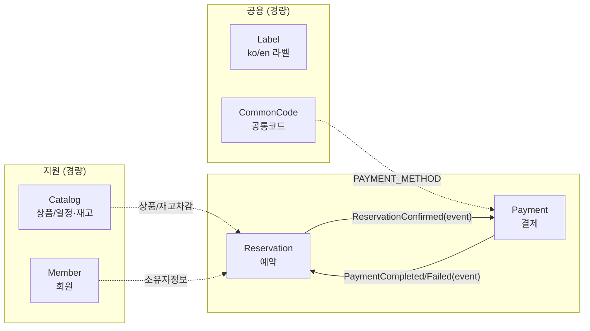
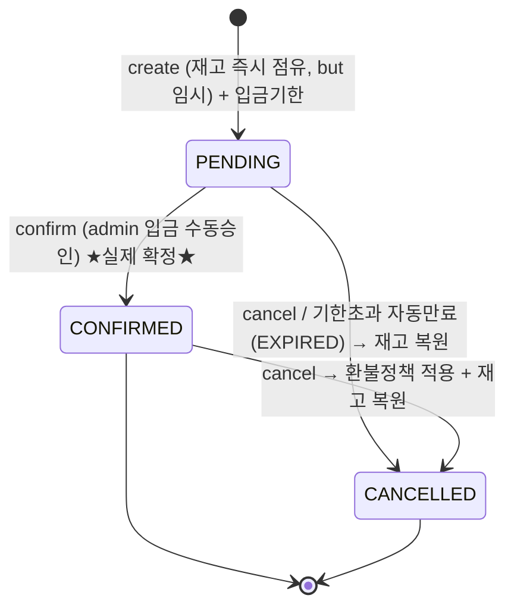

# 02. 도메인 모델 & 용어사전 (DDD)

**선택적 DDD**: 예약·결제는 전술적 DDD, 전시/라벨/공통코드는 경량. 확장 seam은 1단계·SKILL 참조.

---

## 1. Bounded Context Map

- **컨텍스트 간 통신은 이벤트** (Reservation ↔ Payment). 직접 호출 금지.
- Catalog의 재고 차감만 예외적으로 예약 트랜잭션에 **강한 일관성**으로 포함(원자 UPDATE, oversell 0%).

---

## 2. 핵심 컨텍스트 — Reservation (전술 DDD)

### Aggregate: `Reservation` (루트)
- **불변식**: 재고 0이면 생성 불가 / `CONFIRMED`만 취소 가능 / 금액·통화(KRW) 일관.
- **행위(메서드)**: `create()`(재고 차감 후 PENDING), `confirm()`(입금확인 → CONFIRMED + 이벤트), `cancel()`(→ CANCELLED + 보상이벤트).
- **상태(VO `ReservationStatus`)**:

> **확정되어야 실제 확정**: PENDING은 임시 확보(미입금 시 `payment_deadline` 초과로 자동 만료→재고 회수).
> CONFIRMED(입금승인)만 실제 확정. 취소사유(`cancel_reason`)·환불정책·연관상품은 `08-discovery-and-policy.md`.

### 구성 요소
- **Value Object**: `Money(amount: long, currency=KRW)`, `Reserver(email, phone, name)`(게스트/회원 공통), `ReservationStatus`, `ScheduleRef(productId, scheduleId, saleDate)`.
- **참조**: `memberId`(nullable=게스트), `productScheduleId`(UUID 타입 참조, 교차 스키마 FK 없음).
- **Repository(포트)**: `ReservationRepository` (도메인), JPA 어댑터(인프라).

### 재고 차감 (확장 seam)
- 포트 `StockDeductionStrategy.deduct(scheduleId)` → 기본 `AtomicUpdateStrategy`(`UPDATE ... SET stock=stock-1 WHERE stock>0`).
- 폭주 특가 시 `RedisCounterStrategy`로 교체(무수정 추가).

---

## 3. 핵심 컨텍스트 — Payment (전술 DDD)

### Aggregate: `Payment`
- **불변식**: **예약당 결제 1회(멱등)** — Inbox `UNIQUE(reservation_id)`가 최종 방어선.
- **상태**: `REQUESTED`(요청/대기) → `PAID`(완료) → `CANCELLED/REFUNDED`. 계좌이체는 admin 수동승인 시 `PAID`.
- **VO**: `Money(KRW)`, `PaymentMethod`(공통코드 `PAYMENT_METHOD` 매핑: 현재 `BANK_TRANSFER`만 활성).

### 확장 seam
- **포트 `PaymentGateway`**: 결제수단별 어댑터. 현재 `BankTransferGateway`(수동). 추후 `NaverPay/KakaoPay/TossPay/CardGateway` 추가 = 코드 1건 + 어댑터 1개.
- **포트 `PaymentConfirmation`**: 입금확인 전략. 기본 `ManualConfirmation`(admin), 추후 `FirmBankingConfirmation`(가상계좌/펌뱅킹 웹훅, 멱등) 교체.

---

## 4. 지원/공용 컨텍스트 (경량, 승격 가능)

### Catalog (상품/일정·재고/분류/검색)
- `Product`: 상품 메타. **`stock_type`**(`LIMITED`/`UNLIMITED`)로 재고형 구분.
- `ProductSchedule`: **날짜별 재고/가격** (`productId, saleDate, stock, price`). 재고 차감의 강한 일관성 대상.
- 전시/조회는 경량 쿼리. (승격 seam: package-by-context, 로직은 서비스에 둠)

#### 분류 체계 — 데이터 기반 카테고리 (athometrip 하드코딩 라우트 탈피)
- **`Category`**: **self-reference 트리** (`parent_id, level, sort, slug, use_yn`) + **`type`**(`THEME`/`DESTINATION`).
  - athometrip은 카테고리를 라우트에 하드코딩 → 운영자가 못 늘림. thaiuniontour는 **admin이 트리를 직접 관리**.
  - `type` 하나로 테마 트리와 지역 트리를 **같은 구조**로 다룸 (확장 seam).
- **주 네비게이션 = 테마 3단계** (`THEME`): 대분류(투어/액티비티·체험/입장권/교통·픽업/패키지) > 중분류(근교투어 등) > 소분류(아유타야 투어 등).
- **지역 = 패싯 필터** (`DESTINATION`): 방콕/푸켓/치앙마이/파타야/끄라비… (태국 단일국가 → 도시 레벨이면 충분, 필요시 트리 확장).
- **`ProductCategory`**: 상품↔카테고리 N:M 매핑(테마 1개+ / 지역 1개+ 태깅). 대표(primary) 플래그로 브레드크럼·정렬 기준.

#### 검색 (athometrip엔 없던 글로벌 검색)
- 상품명/설명 **풀텍스트 검색**: PostgreSQL `tsvector` + **GIN 인덱스** (ko/en). 오탈자 대응은 `pg_trgm`(선택).
- 자동완성(상품명/카테고리), 필터 결합(지역·가격·테마), 정렬(인기/가격/날짜).
- 검색·필터는 **읽기 전용 경량 쿼리** (CQRS 아님, 단순 조회 서비스).

### Member
- `Member(id, email, password, role)`. **Role**: `MEMBER`/`ADMIN` (+ 확장 `PARTNER`). 게스트는 회원 없이 `Reserver` VO로 예약.

### Label (i18n)
- `Label(code, locale, text)`, `code+locale` UNIQUE. locale = `ko`/`en`. 통화는 KRW 고정(다국어 무관).

### CommonCode
- `CommonCode(code_group, code, name, sort, use_yn)`. 예: `PAYMENT_METHOD`, `RESERVATION_STATUS`, `MEMBER_ROLE`. (athometrip `tb_common_code` 참고)

---

## 5. 도메인 이벤트 카탈로그 (= Outbox payload)
모든 payload는 JSONB + **`version`** 필드(스키마 진화 대비).

| 이벤트 | 생산자 | 발행 시점 | 주요 payload | 구독자 |
|---|---|---|---|---|
| `ReservationConfirmed` | Reservation | **admin 입금 수동승인 시** | reservationId, memberId?, amount, method | Payment |
| `PaymentCompleted` | Payment | 결제이력 멱등 적재 후 | reservationId, paymentId, amount | Reservation(상태확정), (알림 etc) |
| `PaymentFailed` | Payment | 결제 실패/거절 | reservationId, reason | Reservation(보상) |
| `ReservationCancelled` | Reservation | 취소/타임아웃 | reservationId, scheduleId | Catalog(재고복원), Payment(환불) |

> 핵심: `ReservationConfirmed`는 **입금 수동승인 시점**에 발행. (자동확인 도입 시 동일 이벤트, 발행 트리거만 교체)
> 결제 실패·취소 시 **재고 복원 보상(SAGA)** 흐름은 `ReservationCancelled`/`PaymentFailed`로 처리.

---

## 6. 용어사전 (Ubiquitous Language, ko/en)

| 한국어 | English | 코드/식별자 | 비고 |
|---|---|---|---|
| 상품 | Product | `product` | stock_type으로 재고형 구분 |
| (날짜별) 일정·재고 | Product Schedule | `product_schedule` | saleDate별 stock/price |
| 카테고리(분류) | Category | `category` | self-ref 트리 + type(THEME/DESTINATION) |
| 테마/지역 | Theme/Destination | category.type | 테마=주 네비 3단계, 지역=패싯 |
| 상품-분류 매핑 | Product Category | `product_category` | N:M, primary 플래그 |
| 검색 | Search | `tsvector`+GIN | 풀텍스트 ko/en |
| 재고형/비재고형 | Limited/Unlimited | `LIMITED`/`UNLIMITED` | |
| 예약 | Reservation | `reservation` | Aggregate Root |
| 예약자(게스트 포함) | Reserver | VO | 회원/비회원 공통 |
| 결제 | Payment | `payment` | Aggregate, 멱등 |
| 결제수단 | Payment Method | 공통코드 `PAYMENT_METHOD` | BANK_TRANSFER(활성) |
| 입금확인(승인) | Deposit Confirmation | `confirm()` | MVP 수동 |
| 회원/권한 | Member/Role | `MEMBER`/`ADMIN` | |
| 공통코드 | Common Code | `common_code` | code_group+code |
| 라벨(다국어) | Label | `label` | code+locale |
| 아웃박스/인박스 | Outbox/Inbox | `outbox`/`payment_history` | 유실0%/중복0% |

---

## 7. 다음 단계(3단계 ERD)로 넘길 확정 포인트
- 스키마-per-도메인: `reservation` / `payment` / `catalog`(or `product`) / `member` / `common`.
- `product_schedule` 테이블 + 재고 컬럼 + 원자 차감.
- **`category`(self-ref 트리 + type) + `product_category`(N:M, primary) — 테마 3단계/지역 패싯.**
- **상품 검색용 `tsvector` 컬럼 + GIN 인덱스(ko/en), (선택) pg_trgm.**
- `reservation.member_id` nullable(게스트) + reserver 컬럼.
- `outbox`(reservation 소유, 부분 인덱스) + `payment_history`(payment 소유, UNIQUE).
- `common_code` / `label` 테이블 구조 확정.
