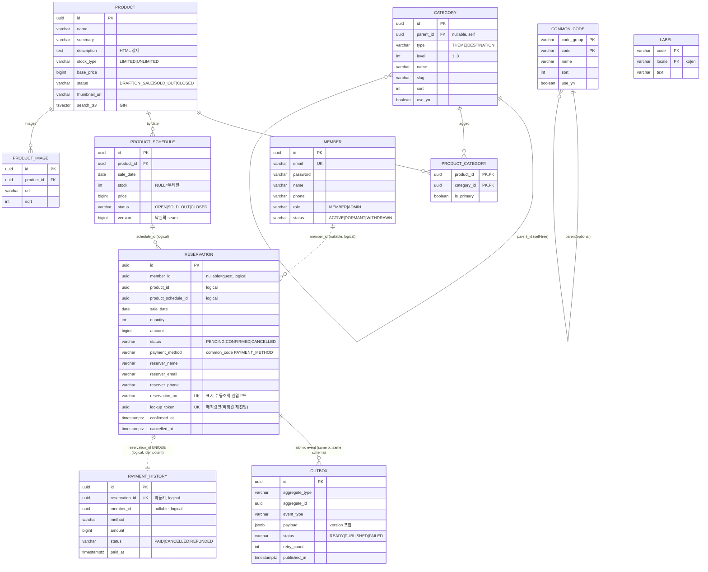

# 03. 데이터 모델 (ERD) — PostgreSQL

**스키마-per-도메인**으로 격리. **교차 스키마 물리 FK 금지**(다른 도메인 식별자는 UUID 타입 참조만).
같은 스키마 내 FK만 허용. 마이그레이션은 Flyway(`V1__...sql`) 가정.

## 표준 규칙
- PK: `UUID PRIMARY KEY DEFAULT gen_random_uuid()`
- 시각: `TIMESTAMPTZ DEFAULT now()` / 날짜: `DATE`
- 금액: `BIGINT`(원 단위, KRW 고정) / 통화 컬럼은 두지 않거나 `'KRW'` 고정
- 명명: snake_case, PK `id`, FK `xxx_id`, 사용여부 `use_yn BOOLEAN`
- **상태값(domain VO) = `VARCHAR` + `CHECK`** (도메인이 통제) / **업무 확장값(결제수단 등) = `common_code`** (운영이 확장)

## 스키마 목록
| 스키마 | 도메인 | 핵심 테이블 |
|---|---|---|
| `common` | 공용 | common_code, label |
| `member` | 회원 | member |
| `catalog` | 상품/분류/재고 | category, product, product_category, product_schedule, product_image |
| `reservation` | 예약(생산자) | reservation, **outbox** |
| `payment` | 결제(소비자) | payment_history(=inbox, 멱등) |

---

## ERD (Mermaid)

> 실선 = 같은 스키마 내 물리 FK. **점선(논리참조)** = 교차 스키마, UUID 타입만(물리 FK 없음).



---

## DDL

### V1 — 스키마 & common
```sql
CREATE EXTENSION IF NOT EXISTS pg_trgm;          -- 부분일치/자동완성 검색용

CREATE SCHEMA IF NOT EXISTS common;
CREATE SCHEMA IF NOT EXISTS member;
CREATE SCHEMA IF NOT EXISTS catalog;
CREATE SCHEMA IF NOT EXISTS reservation;
CREATE SCHEMA IF NOT EXISTS payment;

-- 공통코드: 업무 확장값(결제수단 등) 운영 관리. 상태값은 여기 두지 않음(도메인 CHECK).
CREATE TABLE common.common_code (
    code_group  VARCHAR(50)  NOT NULL,
    code        VARCHAR(50)  NOT NULL,
    name        VARCHAR(100) NOT NULL,
    sort        INT          NOT NULL DEFAULT 0,
    use_yn      BOOLEAN      NOT NULL DEFAULT true,
    created_at  TIMESTAMPTZ  NOT NULL DEFAULT now(),
    updated_at  TIMESTAMPTZ  NOT NULL DEFAULT now(),
    PRIMARY KEY (code_group, code)
);

-- 다국어 라벨: code+locale 유일. locale = ko|en.
CREATE TABLE common.label (
    code    VARCHAR(100) NOT NULL,
    locale  VARCHAR(5)   NOT NULL CHECK (locale IN ('ko','en')),
    text    VARCHAR(500) NOT NULL,
    PRIMARY KEY (code, locale)
);
```

### V2 — member
```sql
CREATE TABLE member.member (
    id          UUID PRIMARY KEY DEFAULT gen_random_uuid(),
    email       VARCHAR(255) NOT NULL UNIQUE,
    password    VARCHAR(255),                       -- 소셜 확장 시 nullable
    name        VARCHAR(100) NOT NULL,
    phone       VARCHAR(30),
    role        VARCHAR(20)  NOT NULL DEFAULT 'MEMBER'
                CHECK (role IN ('MEMBER','ADMIN')), -- 확장: PARTNER
    status      VARCHAR(20)  NOT NULL DEFAULT 'ACTIVE'
                CHECK (status IN ('ACTIVE','DORMANT','WITHDRAWN')),
    created_at  TIMESTAMPTZ  NOT NULL DEFAULT now(),
    updated_at  TIMESTAMPTZ  NOT NULL DEFAULT now()
);
```

### V3 — catalog (분류·상품·재고·검색)
```sql
-- 카테고리: self-ref 트리 + type. 테마(주 네비 3단계)/지역(패싯) 동일 구조.
CREATE TABLE catalog.category (
    id          UUID PRIMARY KEY DEFAULT gen_random_uuid(),
    parent_id   UUID REFERENCES catalog.category(id) ON DELETE CASCADE, -- 동일 스키마 FK OK
    type        VARCHAR(20) NOT NULL CHECK (type IN ('THEME','DESTINATION')),
    level       INT  NOT NULL DEFAULT 1 CHECK (level BETWEEN 1 AND 3),
    name        VARCHAR(100) NOT NULL,
    slug        VARCHAR(120) NOT NULL,
    sort        INT  NOT NULL DEFAULT 0,
    use_yn      BOOLEAN NOT NULL DEFAULT true,
    created_at  TIMESTAMPTZ NOT NULL DEFAULT now(),
    updated_at  TIMESTAMPTZ NOT NULL DEFAULT now(),
    UNIQUE (type, slug)
);
CREATE INDEX idx_category_parent ON catalog.category(parent_id);
CREATE INDEX idx_category_type   ON catalog.category(type, sort);

-- 상품: stock_type으로 재고형 구분. search_tsv는 generated column(GIN).
CREATE TABLE catalog.product (
    id            UUID PRIMARY KEY DEFAULT gen_random_uuid(),
    name          VARCHAR(200) NOT NULL,
    summary       VARCHAR(500),
    description   TEXT,                              -- 상세페이지 HTML(리치에디터)
    stock_type    VARCHAR(20) NOT NULL DEFAULT 'LIMITED'
                  CHECK (stock_type IN ('LIMITED','UNLIMITED')),
    base_price    BIGINT NOT NULL DEFAULT 0,         -- KRW
    status        VARCHAR(20) NOT NULL DEFAULT 'DRAFT'
                  CHECK (status IN ('DRAFT','ON_SALE','SOLD_OUT','CLOSED')),
    thumbnail_url VARCHAR(500),
    search_tsv    tsvector GENERATED ALWAYS AS (
                      to_tsvector('simple',
                        coalesce(name,'') || ' ' || coalesce(summary,''))
                  ) STORED,                          -- 'simple'=ko/en 무난(스테밍 회피)
    created_at    TIMESTAMPTZ NOT NULL DEFAULT now(),
    updated_at    TIMESTAMPTZ NOT NULL DEFAULT now()
);
CREATE INDEX idx_product_search   ON catalog.product USING GIN (search_tsv);     -- 풀텍스트
CREATE INDEX idx_product_name_trgm ON catalog.product USING GIN (name gin_trgm_ops); -- 자동완성/부분일치
CREATE INDEX idx_product_status   ON catalog.product(status);

-- 상품-카테고리 N:M (테마/지역 동시 태깅). primary=브레드크럼/대표분류.
CREATE TABLE catalog.product_category (
    product_id  UUID NOT NULL REFERENCES catalog.product(id)  ON DELETE CASCADE,
    category_id UUID NOT NULL REFERENCES catalog.category(id) ON DELETE CASCADE,
    is_primary  BOOLEAN NOT NULL DEFAULT false,
    PRIMARY KEY (product_id, category_id)
);
CREATE INDEX idx_prodcat_category ON catalog.product_category(category_id);
-- 상품당 type별 primary 1개 보장은 애플리케이션/부분 unique로 관리(선택).

-- 날짜별 재고/가격 — 동시성(선착순)의 핵심 자원. stock NULL=무제한.
CREATE TABLE catalog.product_schedule (
    id          UUID PRIMARY KEY DEFAULT gen_random_uuid(),
    product_id  UUID NOT NULL REFERENCES catalog.product(id) ON DELETE CASCADE,
    sale_date   DATE NOT NULL,
    stock       INT,                                 -- NULL=무제한(UNLIMITED), 정수=한정
    price       BIGINT NOT NULL DEFAULT 0,           -- 날짜별 가격(없으면 base_price)
    status      VARCHAR(20) NOT NULL DEFAULT 'OPEN'
                CHECK (status IN ('OPEN','SOLD_OUT','CLOSED')),
    version     BIGINT NOT NULL DEFAULT 0,           -- 낙관적 락 seam(기본 미사용)
    created_at  TIMESTAMPTZ NOT NULL DEFAULT now(),
    updated_at  TIMESTAMPTZ NOT NULL DEFAULT now(),
    UNIQUE (product_id, sale_date),
    CHECK (stock IS NULL OR stock >= 0)
);
CREATE INDEX idx_schedule_product_date ON catalog.product_schedule(product_id, sale_date);

-- 상세페이지 이미지
CREATE TABLE catalog.product_image (
    id          UUID PRIMARY KEY DEFAULT gen_random_uuid(),
    product_id  UUID NOT NULL REFERENCES catalog.product(id) ON DELETE CASCADE,
    url         VARCHAR(500) NOT NULL,
    sort        INT NOT NULL DEFAULT 0,
    created_at  TIMESTAMPTZ NOT NULL DEFAULT now()
);
CREATE INDEX idx_product_image_product ON catalog.product_image(product_id);
```

**재고 원자 차감 (선착순 기본 전략 — `AtomicUpdateStrategy`)**
```sql
-- 영향 행 1 → 차감 성공 / 0 → 매진(예약 FAILED). UNLIMITED(stock IS NULL)은 차감 스킵.
UPDATE catalog.product_schedule
   SET stock = stock - :qty, updated_at = now()
 WHERE id = :scheduleId
   AND stock IS NOT NULL
   AND stock >= :qty;
```

### V4 — reservation (예약 + Outbox)
```sql
CREATE TABLE reservation.reservation (
    id                   UUID PRIMARY KEY DEFAULT gen_random_uuid(),
    member_id            UUID,                       -- nullable=게스트 (member.member.id 논리참조)
    product_id           UUID NOT NULL,              -- catalog 논리참조
    product_schedule_id  UUID NOT NULL,              -- catalog 논리참조(차감 대상)
    sale_date            DATE NOT NULL,
    quantity             INT  NOT NULL DEFAULT 1 CHECK (quantity > 0),
    amount               BIGINT NOT NULL DEFAULT 0,  -- KRW 결제 총액
    status               VARCHAR(20) NOT NULL DEFAULT 'PENDING'
                         CHECK (status IN ('PENDING','CONFIRMED','CANCELLED')),
    payment_method       VARCHAR(50) NOT NULL DEFAULT 'BANK_TRANSFER', -- common_code PAYMENT_METHOD
    reserver_name        VARCHAR(100) NOT NULL,      -- 게스트/회원 공통 Reserver VO
    reserver_email       VARCHAR(255) NOT NULL,
    reserver_phone       VARCHAR(30)  NOT NULL,
    created_at           TIMESTAMPTZ NOT NULL DEFAULT now(),
    updated_at           TIMESTAMPTZ NOT NULL DEFAULT now(),
    confirmed_at         TIMESTAMPTZ,
    cancelled_at         TIMESTAMPTZ
    -- 좌석 hold seam: 필요시 status에 'HELD' 추가 + held_until TIMESTAMPTZ 컬럼.
);
CREATE INDEX idx_reservation_member   ON reservation.reservation(member_id);
CREATE INDEX idx_reservation_schedule ON reservation.reservation(product_schedule_id);
CREATE INDEX idx_reservation_status   ON reservation.reservation(status);

-- Transactional Outbox (생산자=reservation 소유). 예약 INSERT와 같은 로컬 TX로 원자 커밋.
CREATE TABLE reservation.outbox (
    id              UUID PRIMARY KEY DEFAULT gen_random_uuid(),
    aggregate_type  VARCHAR(50) NOT NULL DEFAULT 'RESERVATION',
    aggregate_id    UUID NOT NULL,
    event_type      VARCHAR(50) NOT NULL,            -- RESERVATION_CONFIRMED 등
    payload         JSONB NOT NULL,                  -- {version, reservationId, amount, ...}
    status          VARCHAR(20) NOT NULL DEFAULT 'READY'
                    CHECK (status IN ('READY','PUBLISHED','FAILED')),
    retry_count     INT NOT NULL DEFAULT 0,
    created_at      TIMESTAMPTZ NOT NULL DEFAULT now(),
    published_at    TIMESTAMPTZ
);
-- 릴레이어가 READY만 빠르게 폴링 (부분 인덱스)
CREATE INDEX idx_outbox_ready ON reservation.outbox(created_at) WHERE status = 'READY';
```

**릴레이어 폴링 (중복발행 방지)**
```sql
SELECT * FROM reservation.outbox
 WHERE status = 'READY'
 ORDER BY created_at
 LIMIT :batch
 FOR UPDATE SKIP LOCKED;     -- 멀티 인스턴스 안전
```

### V5 — payment (소비자 멱등 Inbox)
```sql
-- 결제 이력 = Inbox. reservation_id UNIQUE 가 중복결제 최종 방어선(exactly-once 효과).
CREATE TABLE payment.payment_history (
    id              UUID PRIMARY KEY DEFAULT gen_random_uuid(),
    reservation_id  UUID NOT NULL,                  -- 멱등키 (reservation 논리참조)
    member_id       UUID,                           -- nullable=게스트 (논리참조)
    method          VARCHAR(50) NOT NULL,           -- common_code PAYMENT_METHOD
    amount          BIGINT NOT NULL DEFAULT 0,
    status          VARCHAR(20) NOT NULL DEFAULT 'PAID'
                    CHECK (status IN ('PAID','CANCELLED','REFUNDED')),
    paid_at         TIMESTAMPTZ NOT NULL DEFAULT now(),
    created_at      TIMESTAMPTZ NOT NULL DEFAULT now()
);
CREATE UNIQUE INDEX uq_payment_reservation ON payment.payment_history(reservation_id);
```

### V6 — seed (공통코드/라벨 예시)
```sql
INSERT INTO common.common_code(code_group, code, name, sort, use_yn) VALUES
  ('PAYMENT_METHOD','BANK_TRANSFER','계좌이체',1,true),
  ('PAYMENT_METHOD','NAVER_PAY','네이버페이',2,false),   -- 비활성(확장 대기)
  ('PAYMENT_METHOD','KAKAO_PAY','카카오페이',3,false),
  ('PAYMENT_METHOD','TOSS_PAY','토스페이',4,false),
  ('PAYMENT_METHOD','CARD','카드결제',5,false);

INSERT INTO common.label(code, locale, text) VALUES
  ('product.book','ko','예약하기'), ('product.book','en','Book Now'),
  ('search.placeholder','ko','어떤 여행을 찾으세요?'), ('search.placeholder','en','Where to?');
```

---

## 동시성·이벤트 매핑 요약
| 관심사 | 테이블/컬럼 | 메커니즘 |
|---|---|---|
| 선착순 재고 | `product_schedule.stock` | 원자 UPDATE(`WHERE stock>=qty`), seam: `version`/Redis 카운터 |
| 이벤트 유실 0% | `reservation.outbox` | 예약과 동일 TX 원자 커밋 + 부분 인덱스 |
| 중복 발행 방지 | `outbox` 폴링 | `FOR UPDATE SKIP LOCKED` |
| 중복 결제 0% | `payment_history.reservation_id` | `UNIQUE` (멱등 Inbox) |
| 결제수단 확장 | `common_code(PAYMENT_METHOD)` | 코드 추가 + 어댑터(무수정) |

## 결정 & 근거
- **stock NULL = 무제한**: UNLIMITED 상품도 같은 schedule 구조 재사용, 차감 분기만 `stock IS NOT NULL`. (테이블 이원화 회피)
- **상태=CHECK, 결제수단=common_code**: 상태는 도메인이 통제(코드와 함께 진화), 결제수단은 운영이 확장.
- **검색 `simple` + pg_trgm**: 한국어 형태소 분석기 없이 MVP. seam: 추후 pgroonga/mecab으로 교체.
- **교차 스키마 FK 0개**: reservation↔catalog/member, payment↔reservation 모두 UUID 논리참조 → 도메인 격리.
- **비회원 재진입 = 매직링크 + 예약번호·이메일**(비밀번호 X). `lookup_token`(UUID, 추측불가)으로 이메일 서명링크 조회, `reservation_no`(랜덤·비순차)로 수동 조회. 둘 다 UNIQUE. 게스트에게 비번을 강요하지 않아 마찰↓·보안↑. (생성·메일발송 로직은 M2)

## 다음 단계(4단계 API)로 넘길 포인트
- 예약 생성(동기: 재고차감+PENDING) ↔ 입금 수동승인(CONFIRMED+이벤트 발행) ↔ 결제 처리(비동기) 경계.
- 카테고리 트리 조회 API(메가메뉴), 상품 검색/필터 API(검색+패싯), 상품 상세 API.
- admin: 상품/일정/카테고리 CRUD, 입금 승인.
