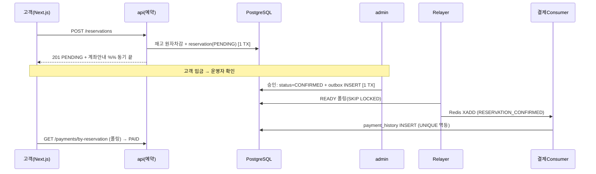

# 04. API 설계

고객 REST API(`api` 모듈, Next.js 소비) + 운영 화면(`admin` 모듈, Thymeleaf 서버렌더).
이 문서는 주로 **고객 REST API**를 정의하고, admin은 화면-액션 단위로 요약한다.

## 공통 규약

### Base & 버전
- 고객 API prefix: `/api/v1`
- admin: `/admin/**` (Thymeleaf, 폼/리다이렉트 — REST 아님)

### 공통 응답 포맷
```json
// 성공
{ "success": true, "data": { ... } }
// 목록(페이지네이션)
{ "success": true, "data": [ ... ],
  "page": { "page": 0, "size": 20, "totalElements": 137, "totalPages": 7 } }
// 실패
{ "success": false, "error": { "code": "RESERVATION_SOLD_OUT", "message": "해당 날짜는 매진되었습니다." } }
```

### 페이지네이션/정렬
- 쿼리: `?page=0&size=20&sort=createdAt,desc`
- 0-base page. 기본 size=20, 최대 100.

### 인증/인가 (JWT)
- 로그인 시 **Access Token(JWT, 짧음)** + **Refresh Token(httpOnly 쿠키)**.
- 헤더: `Authorization: Bearer <accessToken>`.
- 권한: `GUEST`(토큰 없음 허용) / `MEMBER` / `ADMIN`.
- **비회원 예약 허용** → 예약·결제조회 일부는 토큰 없이 가능(예약번호+이메일 조회).

### 에러 코드 체계
`<DOMAIN>_<REASON>` 형식, HTTP status와 매핑.

| code | HTTP | 의미 |
|---|---|---|
| `COMMON_INVALID_PARAM` | 400 | 검증 실패 |
| `AUTH_UNAUTHORIZED` | 401 | 미인증 |
| `AUTH_FORBIDDEN` | 403 | 권한 없음 |
| `COMMON_NOT_FOUND` | 404 | 리소스 없음 |
| `RESERVATION_SOLD_OUT` | 409 | 재고 소진(선착순 실패) |
| `RESERVATION_INVALID_STATE` | 409 | 상태 전이 불가(예: CONFIRMED 아닌데 취소) |
| `PAYMENT_ALREADY_PROCESSED` | 409 | 멱등 중복(이미 결제됨) |
| `COMMON_INTERNAL` | 500 | 서버 오류 |

### DTO 네이밍 (athometrip 계승)
- 요청: `ReqXxxRegist`(등록) / `ReqXxxModify`(수정) / `ReqXxxSearch`(조회조건)
- 응답: `ResXxx` / 목록 `ResXxxList`

---

## 1. 인증 (Auth) — `/api/v1/auth`

| Method | Path | 권한 | 설명 |
|---|---|---|---|
| POST | `/auth/signup` | GUEST | 회원가입(email/password/name/phone) |
| POST | `/auth/login` | GUEST | 로그인 → accessToken + refresh 쿠키 |
| POST | `/auth/refresh` | GUEST(쿠키) | accessToken 재발급 |
| POST | `/auth/logout` | MEMBER | refresh 무효화 |
| GET | `/auth/me` | MEMBER | 내 정보 |

```json
// POST /auth/login → data
{ "accessToken": "eyJ...", "member": { "id": "...", "name": "홍길동", "role": "MEMBER" } }
```

---

## 2. 카테고리 (Category) — `/api/v1/categories`
GNB 메가메뉴/필터용. **테마 트리(주 네비)** 와 **지역(패싯)** 을 type으로 구분.

| Method | Path | 권한 | 설명 |
|---|---|---|---|
| GET | `/categories?type=THEME` | GUEST | 테마 3단계 트리(중첩) — 메가메뉴 |
| GET | `/categories?type=DESTINATION` | GUEST | 지역 목록 — 필터 패싯 |

```json
// GET /categories?type=THEME → data (children 중첩)
[
  { "id": "...", "name": "투어", "slug": "tour", "level": 1,
    "children": [
      { "id": "...", "name": "근교투어", "slug": "suburb", "level": 2,
        "children": [ { "id": "...", "name": "아유타야 투어", "slug": "ayutthaya", "level": 3 } ] }
    ] }
]
```

---

## 3. 상품 (Product) — `/api/v1/products`

| Method | Path | 권한 | 설명 |
|---|---|---|---|
| GET | `/products` | GUEST | **검색/필터/정렬 목록** (아래 파라미터) |
| GET | `/products/{id}` | GUEST | 상품 상세(이미지·설명·일정 요약) |
| GET | `/products/{id}/schedules?from=&to=` | GUEST | 날짜별 재고/가격(예약 캘린더) |
| GET | `/products/autocomplete?q=` | GUEST | 검색 자동완성(상품명/카테고리) |

**`GET /products` 쿼리 파라미터** (검색+패싯, athometrip엔 없던 기능)
| param | 예 | 설명 |
|---|---|---|
| `q` | `아유타야` | 풀텍스트(tsvector)+부분일치(pg_trgm) |
| `categoryId` | uuid | 테마 카테고리(하위 포함) |
| `destinationId` | uuid | 지역 패싯 |
| `minPrice`/`maxPrice` | 50000 | 가격 범위 |
| `saleDate` | 2026-07-01 | 해당 날짜 재고 OPEN만 |
| `sort` | `popular`/`priceAsc`/`priceDesc`/`latest` | 정렬 |

```json
// GET /products/{id} → data
{ "id":"...", "name":"아유타야 1일 투어", "summary":"...", "description":"<html>",
  "stockType":"LIMITED", "basePrice":89000, "status":"ON_SALE",
  "thumbnailUrl":"...", "images":[{"url":"...","sort":0}],
  "categories":{ "theme":[{"id":"...","name":"근교투어"}], "destination":[{"id":"...","name":"방콕"}] },
  "breadcrumb":["투어","근교투어","아유타야 투어"] }
```

---

## 4. 예약 (Reservation) — `/api/v1/reservations`
**동기 경계**: 예약 생성 시 재고 원자 차감 + PENDING 생성까지만 동기 응답. 결제 확정은 비동기(이벤트).

| Method | Path | 권한 | 설명 |
|---|---|---|---|
| POST | `/reservations` | GUEST/MEMBER | 예약 생성(재고차감→PENDING). 비회원=reserver 정보 필수 |
| GET | `/reservations/{id}` | MEMBER/본인 | 예약 상세(상태 포함) |
| GET | `/reservations/by-token/{lookupToken}` | GUEST | **매직링크 조회**(이메일 서명링크 타깃, 1순위) |
| GET | `/reservations/lookup?no=&email=` | GUEST | **수동 조회**(랜덤 예약번호+이메일, fallback) |
| GET | `/reservations/me` | MEMBER | 내 예약 목록 |
| POST | `/reservations/{id}/cancel` | MEMBER/본인 | 취소(상태 검증 → CANCELLED, 재고복원 이벤트). 게스트 취소는 OTP 1회(확장) |

> **비회원 재진입(비밀번호 X)**: 주문확인 이메일에 `lookup_token` 매직링크 포함 → 클릭만으로 조회.
> 수동 조회는 `reservation_no`(랜덤·비순차) + 이메일. 순차번호 금지(열거 방지). 취소 등 민감 작업은 OTP 추가 가능.

```json
// POST /reservations (req)
{ "productId":"...", "productScheduleId":"...", "saleDate":"2026-07-01", "quantity":1,
  "paymentMethod":"BANK_TRANSFER",
  "reserver":{ "name":"홍길동", "email":"a@b.com", "phone":"010-..." } }

// 201 → data  (reservationNo는 랜덤·비순차. 매직링크는 이메일로 발송)
{ "reservationId":"...", "reservationNo":"TUT-7K3P9Q2", "status":"PENDING",
  "amount":89000, "paymentMethod":"BANK_TRANSFER",
  "bankInfo":{ "bank":"국민", "account":"123-456", "holder":"타이유니온투어", "deadline":"2026-06-12T23:59:59+09:00" } }

// 재고 소진 시 → 409 RESERVATION_SOLD_OUT
```

> **흐름**: `POST /reservations` = 재고 원자차감 + reservation(PENDING) INSERT (한 TX). 계좌이체 안내 반환.
> 입금확인(CONFIRMED)은 **admin 수동승인** 시점 → 이때 `RESERVATION_CONFIRMED` 이벤트 발행 → 결제 Consumer가 멱등 처리.

---

## 5. 결제 (Payment) — `/api/v1/payments`
계좌이체 MVP는 **결제=입금 수동승인**이라 고객용 결제 생성 API는 없음. **조회 위주**.
(추후 간편결제/카드 도입 시 `POST /payments/{method}/prepare`·`/confirm`·웹훅 추가 — seam)

| Method | Path | 권한 | 설명 |
|---|---|---|---|
| GET | `/payments/by-reservation/{reservationId}` | MEMBER/본인 | 결제 상태/이력 조회(폴링) |

```json
// GET /payments/by-reservation/{id} → data
{ "reservationId":"...", "status":"PAID", "method":"BANK_TRANSFER", "amount":89000, "paidAt":"..." }
// 미처리 시: { "reservationId":"...", "status":"PENDING" }
```

### (확장 seam) 간편결제/카드 추가 시 예정 엔드포인트
```
POST /payments/{method}/prepare   # PG 결제창 준비(거래키 발급)
POST /payments/{method}/confirm   # 승인 확정
POST /payments/webhook/{provider} # PG 웹훅(멱등: reservation_id UNIQUE로 중복차단)
```

---

## 6. 공통코드/라벨 — `/api/v1`
| Method | Path | 권한 | 설명 |
|---|---|---|---|
| GET | `/common-codes/{group}` | GUEST | 코드 목록(예: `PAYMENT_METHOD` 활성만) |
| GET | `/labels?locale=ko` | GUEST | 다국어 라벨 일괄(프론트 캐시) |

---

## 7. Admin (Thymeleaf, `/admin`) — 화면·액션 요약
REST 아님. 폼 submit + 서버 렌더 + 리다이렉트. 권한 `ADMIN` 고정.

| 화면 | 경로 | 액션 |
|---|---|---|
| 상품 목록/등록/수정 | `/admin/products` | 등록·수정·상세(HTML)·이미지·상태변경 |
| 날짜별 재고 | `/admin/products/{id}/schedules` | 날짜별 stock/price 추가·수정 |
| 카테고리 관리 | `/admin/categories` | 테마/지역 트리 CRUD·정렬 |
| 예약/입금 승인 | `/admin/reservations` | PENDING 목록 → **입금확인 승인**(→CONFIRMED, 이벤트 발행) |
| 결제 조회 | `/admin/payments` | 결제이력 조회 |
| 공통코드 | `/admin/common-codes` | 결제수단 등 코드 on/off·추가 |
| 회원 | `/admin/members` | 회원/권한 조회 |

> **입금 수동승인**이 이벤트 발행 트리거. 승인 = `reservation.confirm()` → outbox INSERT(같은 TX) → 릴레이어 → 결제 Consumer.

---

## 동기/비동기 경계 (핵심)


## 결정 & 근거
- **예약 생성까지만 동기**: 재고 차감은 즉시 확정(선착순), 결제는 이벤트로 분리 → 응답 빠르고 도메인 격리.
- **계좌이체 = 수동승인**이라 고객 결제 API 최소화. 간편결제 seam은 명시만(무수정 확장).
- **비회원 조회는 예약번호+이메일**: 토큰 없는 게스트도 자기 예약 추적.
- **admin은 REST 아님**: athometrip식 Thymeleaf 폼 → 별도 인증/CSRF, 고객 API와 분리.

## 다음 단계(5단계 화면/IA)로 넘길 포인트
- 카테고리 트리 API → 메가메뉴 컴포넌트. 검색/필터 API → 목록 페이지 + 필터 사이드바.
- 예약 캘린더(schedules) → 상세페이지 날짜선택. 비회원 예약조회 페이지.
- 라우팅: `/c/[...slug]`(카테고리), `/search`, `/products/[id]`, `/reservations/lookup`.
