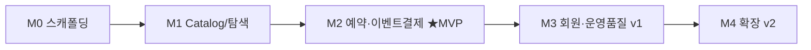

# 07. 백로그 & 마일스톤

설계(0~6)를 **구현 작업 단위**로 분해. 우선순위 MVP → v1 → v2, 마일스톤·의존관계·착수 지점.

## 우선순위 정의
- **MVP**: 상품 등록(admin) → 고객 탐색/검색 → 예약 → 계좌이체 수동승인 → 결제완료. "팔리는" 최소 경로.
- **v1**: 운영 편의·품질(회원/마이페이지·이미지·다국어 라벨·취소/환불·릴레이어 견고화).
- **v2**: 확장(간편결제/카드 PG·자동입금확인·좌석 hold/TTL·리뷰·쿠폰·검색 고도화).

---

## 마일스톤

### M0 — 스캐폴딩 (기반)
| # | 작업 | 산출물 | 의존 |
|---|---|---|---|
| 0.1 | 모노레포 골격 | `backend/`(Gradle 멀티모듈 api·admin·domain·common) `frontend/`(Next14) `docker/` | — |
| 0.2 | docker-compose(local): postgres·redis | 컨테이너 기동 | 0.1 |
| 0.3 | Flyway V1~V6 (03-erd DDL) | 스키마/시드 적용 | 0.2 |
| 0.4 | 공통: 응답포맷·에러코드·예외핸들러·JWT 골격 | `common` | 0.1 |
| 0.5 | 패키지 구조(컨텍스트별 4계층) + DDD 베이스(Aggregate/VO/포트 인터페이스) | 빈 골격 | 0.4 |

### M1 — Catalog & 탐색 (MVP 코어 ①)
| # | 작업 | 영역 | 의존 |
|---|---|---|---|
| 1.1 | category 트리 CRUD (admin) + 조회 API(type별) | admin·api | M0 |
| 1.2 | product 등록/수정/상세(HTML)/이미지 (admin) | admin | M0 |
| 1.3 | product_schedule 날짜별 재고/가격 (admin) | admin | 1.2 |
| 1.4 | 상품 목록 **검색/필터/정렬** API (tsvector+pg_trgm+패싯) | api | 1.2 |
| 1.5 | 상품 상세 + 날짜별 재고 조회 API | api | 1.3 |
| 1.6 | 프론트: 홈·`/c/[...slug]`·`/search`·필터 사이드바·MegaMenu·검색바 | frontend | 1.1,1.4 |
| 1.7 | 프론트: 상품 상세 + 예약 캘린더(BookingPanel) | frontend | 1.5 |

### M2 — 예약 & 이벤트 결제 (MVP 코어 ②) ★핵심
| # | 작업 | 영역 | 의존 |
|---|---|---|---|
| 2.1 | **Reservation Aggregate** + 재고 원자차감(`StockDeductionStrategy`=AtomicUpdate) | domain | M1 |
| 2.2 | 예약 생성 API(재고차감+PENDING, 1 TX) + 비회원 reserver | api | 2.1 |
| 2.3 | **Transactional Outbox**(예약/이벤트 동일 TX) | domain·reservation | 2.2 |
| 2.4 | **Relayer**(@Scheduled, FOR UPDATE SKIP LOCKED, Redis XADD) | api(내부) | 2.3 |
| 2.5 | **결제 Consumer**(XREAD group, payment_history UNIQUE 멱등) | api(내부) | 2.4 |
| 2.6 | admin **입금 수동승인**(→CONFIRMED + `ReservationConfirmed` 발행) | admin | 2.3 |
| 2.7 | 결제상태 조회 API(폴링) + 예약완료/계좌안내 화면 | api·frontend | 2.5 |
| 2.8 | 비회원 재진입: 매직링크(lookup_token 이메일) + 수동조회(랜덤 reservation_no+이메일). 예약번호 생성기(비순차) | api·frontend | 2.2 |

> M2 완료 = **MVP 끝**(상품 올리고 → 예약 → 입금승인 → 결제완료 전 경로 동작).

### M3 — 회원 & 운영 품질 (v1)
| # | 작업 | 영역 |
|---|---|---|
| 3.1 | 회원가입/로그인/JWT(refresh)·`/auth/me` | api·frontend |
| 3.2 | 마이페이지(내 예약/취소) | api·frontend |
| 3.3 | **예약 취소 → 재고복원 보상(SAGA)**(`ReservationCancelled`) | domain |
| 3.4 | 다국어 라벨(ko/en) Provider + `/labels` | api·frontend |
| 3.5 | Relayer 견고화: 재시도/FAILED 재처리 admin 화면 | admin |
| 3.6 | 이미지 업로드 저장소(`FileStorage` 포트, 로컬볼륨) | backend |
| 3.7 | backend-api/admin/nginx 컨테이너화 + 통합 compose | docker |

### M4 — 확장 (v2, seam만 열려 있음)
| # | 작업 | 비고 |
|---|---|---|
| 4.1 | 간편결제/카드 PG(`PaymentGateway` 어댑터 + 코드 활성화) | prepare/confirm/webhook |
| 4.2 | 자동 입금확인(`FirmBankingConfirmation`) | 수동→자동 교체 |
| 4.3 | 좌석 임시점유 hold + Redis TTL | 예약에 HELD 상태 추가 |
| 4.4 | 폭주 특가: `RedisCounterStrategy` | 무수정 전략 추가 |
| 4.5 | 리뷰·쿠폰·파트너 / 검색 고도화(pgroonga) | |
| 4.6 | 파이 배포 확정(arm64 buildx·TLS·백업·CI/CD·모니터링) | 06-infra 확장 |

---

## 의존 흐름

## MVP 완료 기준 (Definition of Done)
- [ ] admin에서 상품+날짜별 재고 등록, 카테고리 분류 가능
- [ ] 고객이 검색/필터로 상품 찾고 상세에서 날짜 선택해 예약
- [ ] 재고 1개 동시 예약 시 **정확히 1건만 성공**(oversell 0%)
- [ ] 예약=PENDING, admin 입금승인 → 이벤트 → 결제이력 멱등 적재 → 고객 결제완료 확인
- [ ] 비회원 예약·조회 동작

## 즉시 착수 지점 (구현 1순위)
1. **M0.1~0.3**: 모노레포 골격 + compose(postgres·redis) + Flyway DDL → "스키마가 뜨는" 상태.
2. **M1.2~1.3**: admin 상품/재고 등록(데이터 투입 경로 확보).
3. **M2.1~2.6**: 예약+Outbox+Relayer+Consumer+입금승인(핵심 가치).

> 권장: **세로 슬라이스**로 진행(상품 1종 등록 → 예약 → 결제완료까지 관통) 후 가로 확장.

---

## M0 확장성 검토 후속 (architect 리뷰 반영)
M0에서 **지금 적용 완료**: default_schema 제거(@Table 스키마 명시 컨벤션) · domain 컨텍스트 패키지 골격 · 포트 인터페이스(StockDeductionStrategy/PaymentGateway/PaymentConfirmation/FileStorage) · AggregateRoot 베이스 · Flyway 소유권 문서화.

**아래는 의도적으로 해당 마일스톤으로 미룸**(지금 만들면 over-engineering):
- [ ] **M2**: `reservation.reservation`에 `version` 컬럼(낙관락) 추가 — 동시 상태전이(승인 vs 취소) 대비. `ALTER TABLE ADD COLUMN`(신규 V7).
- [ ] **M2**: `DomainEventSerializer`(이벤트→Outbox JSONB, **payload에 `schemaVersion` 항상 포함**) — Outbox 구현 시.
- [ ] **M1**: 프론트 `lib/api.ts`·`lib/hooks/` 데이터 패칭 컨벤션 — 첫 API 연동 시.
- [ ] **M3**: Spring 프로필 분리(`application-local.yml`/`application-prod.yml`) — 배포 단계.
- [ ] **M3**: `layout.tsx` `lang` 동적화(ko/en) — i18n 구현 시.

---

## 설계 완료
0~7단계 설계 종료. 다음은 **구현 단계**(이 design 스킬 범위 밖).
구현 착수 시 M0부터. 각 마일스톤 후 동시성/멱등 테스트로 검증.
