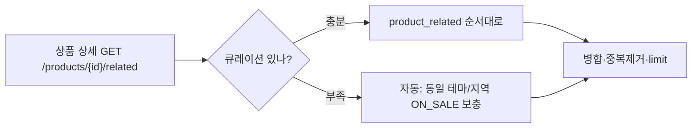
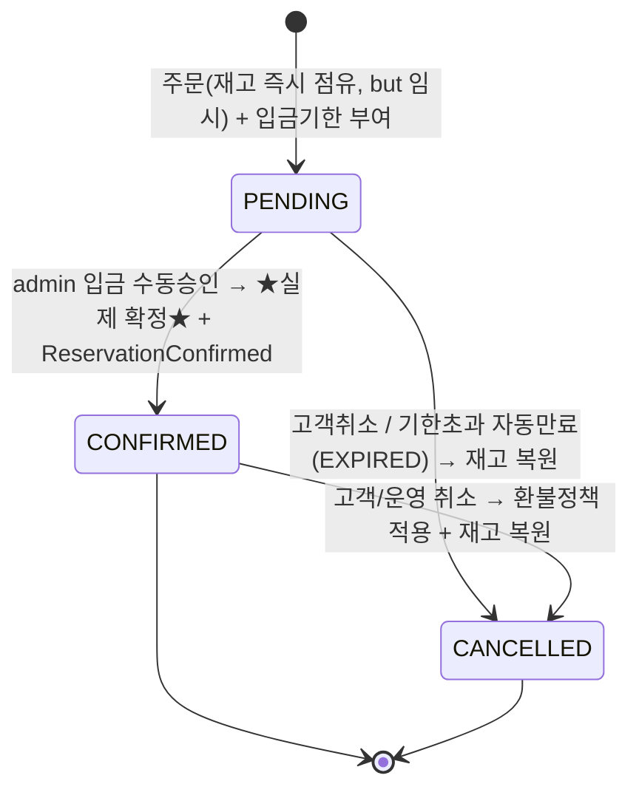

# 08. 탐색(검색·연관상품) & 정책(취소·환불) & 예약 확정 라이프사이클

기존 7단계 설계에 4가지를 추가한다. 스키마는 `V7__discovery_and_policy.sql`.

---

## 1. 검색 (정리/보강)
기존 ERD/API에 정의된 검색을 한 곳에 정리.

- **대상 필드**: `product.name` + `summary` → `search_tsv`(generated, `to_tsvector('simple')`). 상세(`description`)는 노이즈가 커서 제외(필요 시 가중치 낮게 추가).
- **인덱스**: `GIN(search_tsv)`(토큰 일치) + `GIN(name gin_trgm_ops)`(부분일치/자동완성).
- **랭킹**: 기본 `ts_rank` + 인기/최신 보정. MVP는 단순(이름 부분일치 우선 → 풀텍스트). 정렬 옵션은 `popular/priceAsc/priceDesc/latest`.
- **필터 결합(패싯)**: 테마 카테고리, 지역(DESTINATION), 가격, 판매일(OPEN 재고) — `GET /products` 쿼리.
- **자동완성**: `GET /products/autocomplete?q=` (상품명/카테고리 prefix).
- **한국어 seam**: `simple`(무형태소)로 시작. 품질 필요 시 pgroonga/mecab 교체(reference-patterns.md seam).

---

## 2. 연관상품 (신규)
상품 상세 하단 "함께 보면 좋은 상품".

- **모델**: `catalog.product_related`(product_id, related_product_id, sort) — **admin 수동 큐레이션**(N:M self, 자기참조 금지 CHECK).
- **자동 fallback**: 큐레이션이 부족하면 **같은 테마(primary) 또는 같은 지역** 상품으로 채움(쿼리, 별도 테이블 불필요).
- **API**: `GET /products/{id}/related?limit=8` → 큐레이션 우선 + 자동 보충(중복·자기 제외, ON_SALE만).
- **확장 seam**: v2에서 행동기반("이 상품 본 사람이 본/예약한") 추가 가능 — 인터페이스는 동일 엔드포인트 뒤로 숨김.

---

## 3. 취소/환불 정책 (신규)
여행상품은 출발일 임박도에 따라 환불율이 달라진다. **재사용 정책 템플릿**을 admin이 정의하고 상품이 참조.

- **모델**:
  - `catalog.cancellation_policy`(id, name, description) — 예: "표준 취소정책".
  - `catalog.cancellation_policy_rule`(policy_id, **min_days_before**, **refund_rate**).
  - `catalog.product.cancellation_policy_id` → 상품이 정책 1개 참조(catalog 내부 FK).
- **환불율 산정**: 출발(`sale_date`)까지 잔여일 `d` 일 때 → `min_days_before <= d` 인 규칙 중 **min_days_before 최댓값**의 `refund_rate` 적용.
  - 시드 예시: `{7→100%, 3→50%, 0→0%}`. d=5 → 50%, d=10 → 100%, d=1 → 0%.
- **환불 처리**: `payment.refund`(reservation당 1건 UNIQUE, 정책 적용 amount/refund_rate/reason/status). 계좌이체 MVP는 **수동 송금** → admin이 `COMPLETED` 처리.
- **확장 seam**: 자동 환불(PG 취소 API)은 `PaymentGateway` 어댑터로 추가. 정책에 "환불불가 상품(특가)" = 규칙 `{0→0}` 단일.

---

## 4. 예약 확정 라이프사이클 — "확정되어야 실제 확정"
**핵심 원칙: PENDING은 임시 확보일 뿐, 입금이 확인(CONFIRMED)되어야 실제 확정이다.**

- **PENDING(임시 확보)**: 주문 시 재고를 즉시 차감(선착순 보장)하되 **확정 아님**. `payment_deadline`(예: 주문+48h) 부여.
  - **자동 만료**: 스케줄러 `ReservationExpirySweeper`(@Scheduled)가 `status=PENDING AND payment_deadline < now()` 를 찾아 → CANCELLED(`cancel_reason=EXPIRED`) + **재고 복원** + `ReservationCancelled(reason=EXPIRED)` 발행. (부분 인덱스 `idx_reservation_pending_deadline`)
  - PENDING 취소는 미입금이므로 환불 없음(재고만 복원).
- **CONFIRMED(실제 확정)**: admin 입금승인 시점. 이때만 좌석이 진짜 확정되고 `ReservationConfirmed` 발행.
  - CONFIRMED 취소 = **환불정책 적용** → `payment.refund` 생성(정책 산정액) + 재고 복원 + `ReservationCancelled(reason, refundAmount)`.
- **취소사유**(`cancel_reason`): `CUSTOMER`/`ADMIN`/`EXPIRED` 구분(리포팅·환불판단).

> 왜 이렇게? 입금 전 좌석을 점유하되, 미입금 재고를 영원히 묶지 않도록 **자동 만료로 회수**한다. "예약했다"와 "확정됐다"를 분리해, 실제 확정은 **입금확인 후**임을 도메인·UX·데이터 모두에서 일관되게 표현.

### 이벤트 카탈로그 추가/보강
| 이벤트 | 시점 | payload 추가 | 구독자 |
|---|---|---|---|
| `ReservationCancelled` | 취소/만료 | `reason`, `refundAmount`, `scheduleId` | Catalog(재고복원), Payment(환불생성) |
| `RefundRequested`(선택) | CONFIRMED 취소 | `reservationId`, `amount`, `rate` | (알림/정산) |

---

## 5. ERD 추가 요약 (V7)
| 테이블/컬럼 | 스키마 | 용도 |
|---|---|---|
| `product_related` | catalog | 연관상품 큐레이션 |
| `cancellation_policy` / `_rule` | catalog | 취소/환불 정책 템플릿 |
| `product.cancellation_policy_id` | catalog | 상품→정책 참조 |
| `reservation.payment_deadline` | reservation | 입금기한(만료 기준) |
| `reservation.cancel_reason` | reservation | CUSTOMER/ADMIN/EXPIRED |
| `payment.refund` | payment | 정책 기반 환불(멱등) |

## 6. API 추가 요약
| Method | Path | 설명 |
|---|---|---|
| GET | `/products/{id}/related` | 연관상품(큐레이션+자동) |
| GET | `/products/{id}` | 응답에 `cancellationPolicy`(규칙 요약) 포함 |
| POST | `/reservations/{id}/cancel` | 취소 → 상태/환불정책 계산, 환불액 반환 |
| GET | `/reservations/{id}/refund` | 환불 상태 조회 |
| (admin) | `/admin/cancellation-policies` | 정책/규칙 CRUD |
| (admin) | `/admin/refunds` | 환불 수동 처리(COMPLETED) |
| (admin) | `/admin/products/{id}/related` | 연관상품 큐레이션 |

## 7. 구현 매핑 (백로그)
- M1: 연관상품(admin 큐레이션 + API), 취소정책 CRUD·상품 연결, 상세에 정책 노출.
- M2: 입금기한 부여 + **ReservationExpirySweeper**(자동 만료/재고복원), 취소→환불 산정·`payment.refund`, admin 환불 처리.
- 검색은 M1.4에 이미 포함(보강).
